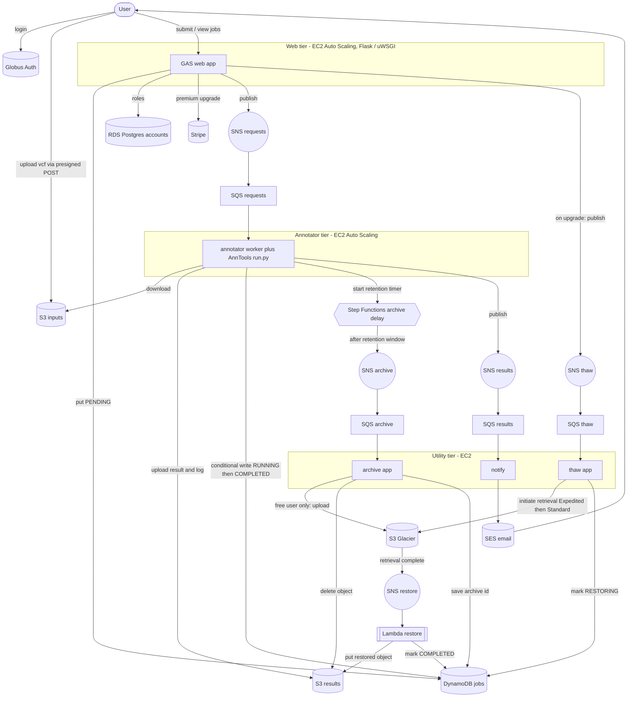

# Cloud-Based Genomic Gene Annotator (GAS)

An event-driven genomics annotation service on AWS: users upload a `.vcf` file, a pool of
worker instances runs the AnnTools annotation pipeline, and results are stored, emailed,
and tiered to cold storage — with each stage scaling independently behind SNS/SQS.

## Architecture



## How a job flows

1. The user logs in through **Globus Auth** and uploads a `.vcf` file straight to **S3** using a
   presigned POST generated by the web app (server-side AES256 encryption, private ACL).
2. The web app writes a `PENDING` job item to **DynamoDB** and publishes the job to the
   **SNS requests** topic.
3. SNS fans the message into the **SQS requests** queue. An **annotator** instance pulls it,
   downloads the input from S3, and spawns the **AnnTools** pipeline (`run.py`). It flips the job
   `PENDING -> RUNNING` with a DynamoDB conditional write.
4. When annotation finishes, `run.py` uploads the result and log files to **S3 results**, marks the
   job `COMPLETED` in DynamoDB, starts a **Step Functions** retention timer, and publishes to the
   **SNS results** topic.
5. The **notify** service reads the results queue and emails the user a link to their results via **SES**.
6. After the retention window, Step Functions triggers the **archive** service (via SNS -> SQS). For
   **free users**, the result is uploaded to **Glacier**, the archive id is saved to DynamoDB, and the
   S3 copy is deleted. Premium users are skipped.
7. If a user upgrades (via **Stripe**), the web app publishes their archived jobs to the **SNS thaw**
   topic. The **thaw** service starts a Glacier retrieval (Expedited, falling back to Standard). When
   the retrieval completes, Glacier notifies the **restore** Lambda, which copies the object back to
   S3 and marks the job `COMPLETED`.

## Components

- **`web/`** — Flask web app (served by uWSGI over HTTPS on port 4433). Handles Globus login, file
  upload via presigned S3 POST, job submission, the annotations list/detail pages, and Stripe-based
  premium subscriptions. User profiles/roles live in RDS (PostgreSQL via SQLAlchemy).
- **`ann/`** — the annotator tier. `annotator.py` polls the requests queue (or `annotator_webhook.py`
  runs the same logic as an SNS webhook on port 5000); `run.py` wraps the **AnnTools** pipeline and
  handles result upload, DynamoDB updates, the Step Functions timer, and result notification.
- **`util/archive/`** — Flask app (port 5001) that archives free-user results to Glacier.
- **`util/notify/`** — worker that emails users when a job completes (SES).
- **`util/thaw/`** — Flask app (port 5002) that initiates Glacier retrieval for upgraded users.
- **`util/restore/`** — `restore.py`, the AWS Lambda that copies thawed archives back to S3.
- **`aws/`** — EC2 user-data scripts used by the Auto Scaling launch configurations.

## Design decisions

- **Event-driven tiers that scale independently.** Every stage is decoupled by SNS -> SQS, so the web,
  annotator, and utility tiers consume at their own pace and scale on their own queue depth rather than
  on each other.
- **Idempotent workers under at-least-once delivery.** SQS can deliver a message more than once, so the
  annotator claims a job with a DynamoDB conditional write (`job_status = PENDING -> RUNNING`); a
  duplicate delivery fails the condition and is dropped instead of re-run.
- **Tiered storage for cost.** Free-user results are moved to Glacier after a retention window and
  deleted from S3; when a user upgrades, results are thawed back. Thaw tries **Expedited** retrieval and
  falls back to **Standard** on `InsufficientCapacityException`.
- **Step Functions for the retention delay.** Rather than hold a worker or a timer, `run.py` starts a
  state machine that waits out the free-tier retention window and then triggers archival.
- **Lambda for restore.** Glacier retrieval is asynchronous, so completion is handled by an
  SNS-triggered Lambda instead of a long-running poller.
- **Auto Scaling on EC2.** The web and annotator tiers run behind Auto Scaling groups configured from
  the `aws/` user-data scripts, so capacity follows load.
- **Secrets stay out of the code.** All credentials (Flask key, RDS, Globus, AnnTools DB) are read from
  **AWS Secrets Manager** at runtime, with environment-variable fallbacks; config files ship as
  `*.example` templates.

## AWS services used

| Service | Role in this project |
| --- | --- |
| EC2 + Auto Scaling | Host the web, annotator, and utility tiers; scale each tier on its own load |
| S3 | Store uploaded `.vcf` inputs and annotation results (AES256, private, presigned URLs) |
| SNS | Fan-out of job events: requests, results, archive, thaw, restore |
| SQS | Buffer work for each worker tier (requests, results, archive, thaw) |
| DynamoDB | Job/annotation state table; conditional writes for idempotency; GSI by `user_id` |
| RDS (PostgreSQL) | User accounts and roles (free vs. premium) |
| RDS (MySQL) | Reference database queried by the AnnTools engine (`ann/utils.py`) |
| S3 Glacier | Long-term archive of free-tier results; retrieval on upgrade |
| Lambda | `restore.py` — copies a thawed archive back to S3 |
| Step Functions | Delay state machine enforcing the free-tier retention window before archival |
| Secrets Manager | Runtime secrets (Flask key, RDS creds, Globus client secret) |
| SES | Job-completion email notifications |

External (non-AWS): **Globus Auth** for login/identity and **Stripe** for premium subscriptions.

## How to run

1. **Install dependencies** per tier: `pip install -r web/requirements.txt` (and likewise for
   `ann/` and `util/`).
2. **Create config from the templates** and fill in your own AWS resource names:
   ```bash
   cp ann/annotator_config.ini.example   ann/annotator_config.ini
   cp util/util_config.ini.example       util/util_config.ini
   cp util/notify/notify_config.ini.example util/notify/notify_config.ini
   ```
   These real files are git-ignored. Replace every `<PLACEHOLDER>` (account id, region, bucket names,
   topic/queue ARNs).
3. **Provision secrets.** The web/util Python configs read from AWS Secrets Manager
   (`gas/web_server`, `rds/accounts_database`, `globus/auth_client`, `rds/anntools_database`). For local
   runs you can instead set the matching environment variables (e.g. `FLASK_SECRET_KEY`,
   `AWS_S3_INPUTS_BUCKET`, `AWS_REGION_NAME`).
4. **Deploy** with the `aws/` user-data scripts (the web user-data pulls the app zip from S3 and starts
   it) and launch each tier:
   - Web: `web/run_gas.sh` (uWSGI, HTTPS :4433)
   - Annotator: `ann/run_ann.sh` (polling worker) or `ann/run_ann_webhook.sh` (webhook :5000)
   - Notify: `util/notify/run_notify.sh`
   - Archive: `util/archive/run_archive_app.sh` (:5001)
   - Thaw: `util/thaw/run_thaw_app.sh` (:5002)
   - Restore: deploy `util/restore/restore.py` as a Lambda subscribed to the restore SNS topic.

## What I would improve

- **Infrastructure as code** (Terraform/CDK) instead of manual console setup, so the SNS/SQS/Step
  Functions/IAM wiring is reproducible.
- **Containers** (Docker on ECS/Fargate) instead of EC2 user-data that pulls a zip from S3.
- **Dead-letter queues** on each SQS queue, plus CI tests and CloudWatch metrics/alarms in place of
  `print()` logging.
- **Harden the data layer**: `util/helpers.get_user_profile` builds a SQL string with an f-string;
  switch to parameterized queries. Also remove the leftover assignment-specific resource naming
  (`a17_*`) and make it fully config-driven.

## Context

Built as the final project for the **MPCS Cloud Computing** course at the **University of Chicago**
(2025–2026). This is the GAS (Genomics Annotation Service) assignment series.

Code I did **not** write (kept with original attribution):
- The **AnnTools** pipeline — `ann/driver.py`, `annotate.py`, `pileup2vcf.py`, `file_utils.py`,
  `utils.py` — originally by Vlad Makarov & Chris Yoon (2011, BSD), adapted for the course.
- Course-provided scaffolding marked *"DO NOT MODIFY"* (e.g. `web/app.py`, `web/models.py`,
  `web/decorators.py`, `web/auth.py`, `web/helpers.py`) and the `thaw_app_config_local.py` template.

My work is the cloud orchestration: the job-submission logic in `web/views.py`, the annotator workers
(`ann/annotator.py`, `run.py`, `annotator_webhook.py`), the utility services (archive, thaw, restore,
notify), and the SNS/SQS/Step Functions/Lambda wiring that ties them together.
